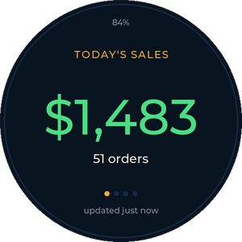
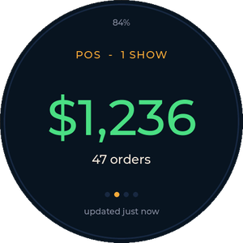
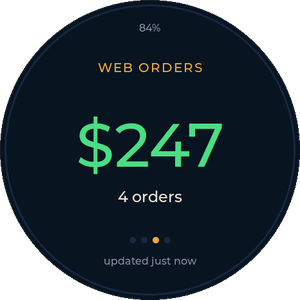
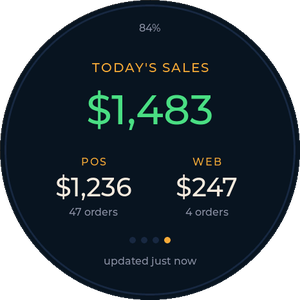

# esp32-desk-dials

Round desk dials that show your sales at a glance, built on the
**Waveshare ESP32-S3-Touch-AMOLED-1.75** (466×466 round AMOLED, touch, battery-ready).

| | | | |
|:-:|:-:|:-:|:-:|
|  |  |  |  |
| Total | POS only | Web only | All three |

**Install from your browser: [dial.varo.industries](https://dial.varo.industries)** (Sales Dial: [/sales/](https://dial.varo.industries/sales/)) — Chrome or Edge on a
desktop, a USB-C data cable, one click. No toolchain needed.

## What a dial can show

- **FairKeep** ([fairkeep.app](https://fairkeep.app)) — today's takings across every show on your
  calendar plus Shopify web orders: Total, POS only, Web only, or all three at once. Uses a FairKeep
  API key with *Reports read* (Vendor plan). The numbers are the same ones as FairKeep's Live View.
- **Etsy** — a shop's **Today / This month / This year**: orders and gross income, or the figure after
  Etsy fees (optionally after postage labels too). Reads an [Etsy dial service](etsy-service/) that holds
  the shop's Etsy authorization. A fourth view counts orders waiting to ship (amber when one is due
  today, red when one is overdue).
- **Server status** — every Coolify app, service and database, every domain and every Hetzner server,
  one dot each round the edge, with what's broken listed underneath; a second view shows each server's
  CPU. Reads a [status service](status-service/) you host with read-only tokens.

On the dial: **tap** to change view (or lock a dial to one view), **press and hold** to refresh.
Setup is from your phone: first boot opens a `DeskDial-Setup` WiFi hotspot where you pick your
network and paste a key. After that, everything lives on the dial's own settings page
(`http://deskdial.local/`).

## Repository layout

| Folder | What |
|--------|------|
| [`firmware/`](firmware/) | PlatformIO / Arduino firmware (LVGL 8) |
| [`etsy-service/`](etsy-service/) | Small Python service that turns a shop's Etsy orders and ledger into dial numbers |
| [`status-service/`](status-service/) | Small Python service that rolls Hetzner Cloud, Coolify and HTTPS checks into one status for the dials |
| [`docs/`](docs/) | The browser installer, served by GitHub Pages at dial.varo.industries |

## Build it yourself

```
cd firmware
pio run -t upload                 # build + flash over USB
python tools/make_release.py      # rebuild docs/ (installer image + OTA image + manifest)
```

Updates can also be uploaded from the dial's settings page (`VARODeskDial-ota.bin`).

## Credits and licenses

MIT — see [LICENSE](LICENSE). Display, touch and power code adapted from
[Capsule Radar](https://github.com/socquique/capsule-radar) (MIT); digits in Montserrat (OFL 1.1).
Details in [THIRD_PARTY_NOTICES.md](THIRD_PARTY_NOTICES.md).

Made by [VARO Industries](https://varo.industries).

*The term 'Etsy' is a trademark of Etsy, Inc. This application uses the Etsy API but is not endorsed or
certified by Etsy, Inc.*
